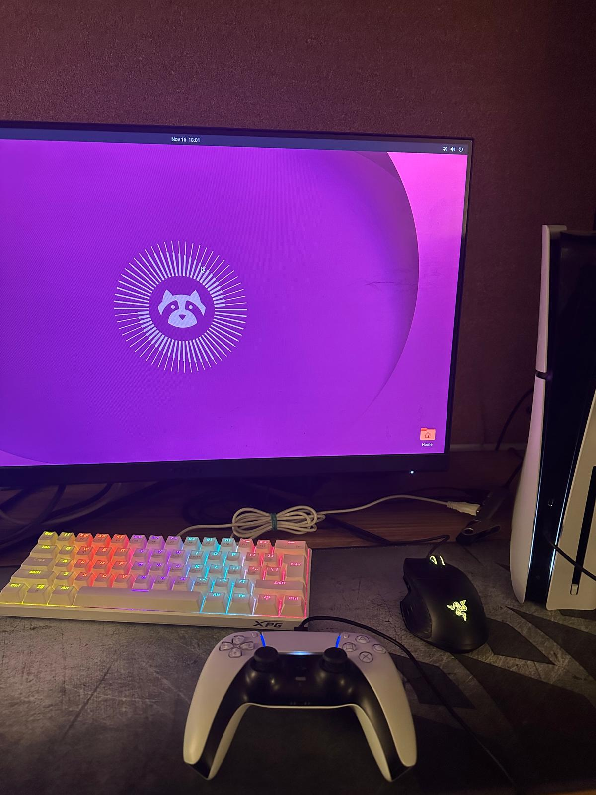

# PS5 Slim as a Linux Box and Local AI Server

I turned a PS5 Slim into a Linux machine, then used it to run a 27B AI model that I reach from my laptop over the home network. These are my build logs: what I set up, what broke, and how I fixed it.

## Guides

| Part | What it covers |
|---|---|
| [1. Booting Linux](linux-boot/README.md) | Ubuntu 26.04 on firmware 13.60: moving to an internal M.2 SSD, fixing the black screen, working around unsupported Wi-Fi |
| [2. Local AI server](local-ai/README.md) | Qwen3.8 27B on the PS5's GPU with llama.cpp, used from a harness on my laptop: memory limits, headless setup, speed results |

## Status

- **Linux:** working
- **Local AI:** model runs at 17-25 tokens/sec. The harness still hits out-of-memory errors, and I'm testing other harnesses and models.

## Built on

- [ps5-linux](https://github.com/ps5-linux) projects and the [13.60 loader fork](https://github.com/soniciso1/ps5-linux-loader)
- [llama.cpp](https://github.com/ggml-org/llama.cpp)

This repo documents my own setup on a console I own. It contains no exploit files, keys, or firmware. Not affiliated with Sony.
