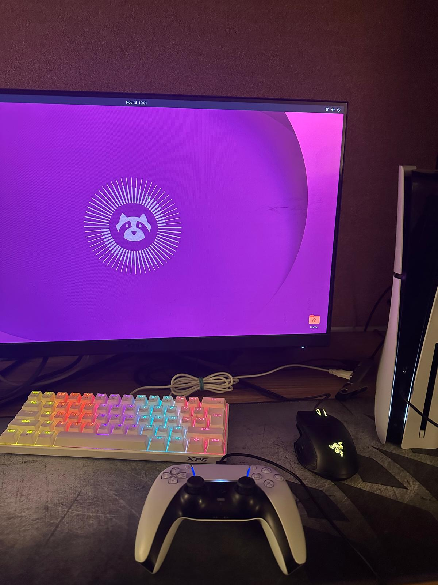

# Booting Linux on a PS5 Slim (and Fixing the Problems Along the Way)

A troubleshooting log from getting Linux to boot on a PS5 Slim. It covers my settings, a storage problem with an external M.2 enclosure, the black-screen problem, and Wi-Fi not being detected, plus how I fixed each one.

> **Scope:** this is documentation of my own configuration on a console I own. It contains no exploit files, keys, firmware dumps, or copyrighted material. Not affiliated with Sony. Everything here is at your own risk.

**Part 2:** running a local AI model on this setup is in [the local AI guide](../local-ai/README.md).



*The result: Ubuntu 26.04 booted on my PS5 Slim (right), with a USB keyboard, mouse and DualSense connected.*

## At a glance

| # | Problem | Solution |
|---|---|---|
| 1 | The M.2 SSD in an external enclosure was not detected over USB 3.0 or higher, and only worked over USB 2 | Mount the SSD internally with a heatsink, and boot Linux from a USB drive first |
| 2 | Repeated black screen on boot | Specific console display settings plus two `cmdline.txt` changes |
| 3 | Wi-Fi not detected in Linux | Connect over Ethernet |

## Hardware and software

| Item | Detail |
|---|---|
| Console | PS5 Slim |
| Firmware | 13.60 |
| Monitor | MSI Optix G271 (1080p) |
| Linux distro | Ubuntu 26.04, from the [ps5-linux-image `latest` release](https://github.com/ps5-linux/ps5-linux-image/releases/tag/latest) (`ps5-ubuntu2604.img.xz`) |
| Boot drive | 64 GB USB stick, connected through a USB dock to the lower rear USB port |
| Linux storage | M.2 SSD with a [be quiet! MC1](https://www.bequiet.com/en/accessories/2251) heatsink, mounted internally |
| Network | Ethernet (built-in Wi-Fi not supported on my console, see Problem 3) |

## Built on

This setup is built on the open-source **ps5-linux** projects:

- Loader: [soniciso1/ps5-linux-loader](https://github.com/soniciso1/ps5-linux-loader), a fork that adds firmware 13.60 support (including PS5 Pro), based on [ps5-linux/ps5-linux-loader](https://github.com/ps5-linux/ps5-linux-loader) (GPL-3.0)
- Image: [ps5-linux/ps5-linux-image](https://github.com/ps5-linux/ps5-linux-image)

I do not reproduce the jailbreak or exploit steps here. Follow those projects' own documentation, and see their Credits sections for the people who built them. This log only covers my configuration and what I learned.

---

## Problem 1: the external M.2 enclosure was not detected

**Setup:** I started by putting the M.2 SSD in a generic NVMe enclosure and connecting it to the PS5.

**Symptom:** with the enclosure's own USB 3.0 cable, the drive was not detected. The same happened with every USB 3.0 or faster cable I tried. It only worked with a USB 2.0 cable (an Apple USB Type-A to Type-C cable), which was slow.

**Possible causes (not confirmed):**

1. **The enclosure is incompatible** with the PS5 at USB 3 speeds.
2. **The known I/O issue on firmware 13.60** listed by the loader fork. Its details aren't published, so I can't rule it out.

I switched to an internal mount instead of finding the exact cause.

### Solution: mount the SSD internally

1. **Add a heatsink.** I bought the [be quiet! MC1](https://www.bequiet.com/en/accessories/2251) (M.2 2280, listed by the maker as compatible with the PS5 M.2 slot) and fitted it to the SSD.
2. **Install the SSD inside the PS5** in its M.2 slot.
3. **Boot Linux from a USB drive first.** Running Linux from an internal SSD needs a USB boot first. I used a 64 GB USB stick.
4. **Initialize and install Linux on the M.2,** following the [loader project's M.2 installation steps](https://github.com/soniciso1/ps5-linux-loader#m2-installation). From the USB-booted Linux, its `ps5-linux-tools` scripts initialize the M.2 (`m2_init`), then install the Linux image onto it (`m2_install.sh`).
5. **Only after that, point the boot line at the M.2.** Once the M.2 is initialized and Linux is installed on it, edit `/boot/efi/cmdline.txt` and change `root=LABEL=ubuntu2604` to `root=LABEL=ubuntu2604-m2`, so Linux always boots from the M.2.

Notes:
- The M.2 drive is dedicated to Linux in this setup, so it can't be used for PS5 game storage at the same time.
- The USB drive with the boot (FAT32) partition is still needed when running from M.2.
- USB ports: the rear Type-A ports and the front Type-C port are supported for booting. The front top Type-A port is USB 2.0 only, so avoid it.
- Keyboard: connected to the **lower rear USB port** (through the dock) while booting.

---

## Problem 2: black screen on boot

**Symptom:** repeated black screens when booting Linux.

### Why it happens

The PS5's GPU does not drive the HDMI port directly. It outputs **DisplayPort** (Linux sees the connector as `DP-1`) into an internal chip that converts DisplayPort to HDMI.

Before any picture appears, the GPU and that chip have to agree on a link speed through a handshake called **link training**. If the link settles on a speed lower than its maximum, the converter can fail to lock on, and the screen stays black. In the kernel log this shows up as a clock-recovery failure (`could not get CR after 100 tries` in `dmesg`).

This is most likely at lower resolutions like 1080p, where the link needs less bandwidth and is more likely to drop to a lower speed. That fits what I saw on my 1080p monitor, though I only had one screen and couldn't test another.

Source for this explanation: the [PS5-CachyOS black-screen notes](https://github.com/abrocoma/PS5-CachyOS#7-black-screen). Their CachyOS image adds a boot service (`dp-link-lock.service`) that locks the link at full speed, and they list the official images as needing that fix added. I used the official Ubuntu image, so I solved it with the settings below instead.

### Solution: console settings plus `cmdline.txt` changes

The fix was the combination of the settings and boot parameters below. The loader project's troubleshooting notes suggest the same kinds of changes: removing the `video=DP-1` line, trying HDCP on and off, forcing 1080p, and trying a different display.

**Console settings**

*System Settings -> HDMI*

| Setting | Value |
|---|---|
| HDMI Device Link | Enabled |
| Enable One Touch Play | Enabled |
| HDCP | Enabled |

Note: the loader's setup notes recommend **disabling** HDMI Device Link. My working setup has it enabled. If you get a black screen, try both.

*System Settings -> Features available in Rest Mode*

| Setting | Value |
|---|---|
| Supply power to USB ports | Always |
| Stay connected to the internet | Off |

*Screen and Video -> Video Output*

| Setting | Value |
|---|---|
| Resolution | 1080p |
| VRR | Off |
| 120 Hz output | Off |
| ALLM | Off |
| HDR | Off |
| Deep color output | Off |
| RGB range | Auto |

**Boot parameters (`cmdline.txt`)**

- **Removed:** `video=DP-1:1920x1080@60`
- **Added:** `amdgpu.force_1080p=1`

Resulting full line, including the M.2 label from Problem 1:

```
root=LABEL=ubuntu2604-m2 rw rootwait console=ttyTitania0 console=tty0 mitigations=off idle=halt preempt=full amdgpu.force_1080p=1
```

Note: `mitigations=off` disables CPU vulnerability mitigations. It comes with the image's default boot line.

**Still black?** Try a second display or a capture card, and check `dmesg` for clock-recovery (`CR`) errors.

---

## Problem 3: Wi-Fi not detected

**Symptom:** after booting into Linux, no Wi-Fi adapter showed up.

**Cause:** PS5 consoles ship with different Wi-Fi chips. According to the [loader project's FAQ](https://github.com/soniciso1/ps5-linux-loader#faq), Linux Wi-Fi currently only works on consoles with a **Marvell** Wi-Fi chip, through a separate driver ([ps5-linux-mwifiex](https://github.com/ps5-linux/ps5-linux-mwifiex)). My console's Wi-Fi chip was not detected.

**How to check yours:** run `lspci -nn`. The loader project lists the supported Marvell chip as `Marvell Technology Group Ltd. Device [1b4b:2b56]`. If it's there, you can install the Wi-Fi driver. If not, Wi-Fi won't work for now.

### Solution: use Ethernet

The Ethernet port works on all PS5 models, so I connected the console with an Ethernet cable. A USB Wi-Fi adapter is another option the loader project lists.

---

## Upstream notes worth knowing

- The fork's README lists a known I/O issue on firmware 13.60 that its author was working on. Check the project for the current status.
- The loader project says it needs a USB drive of at least 64 GB, with an external SSD preferred.

## What I would do differently

- **Check part compatibility before ordering.** The generic NVMe enclosure I bought first didn't work with the PS5 at USB 3 speeds, which cost me time and money.
- **Test the UAS theory before switching to an internal mount.** At USB 3 speeds, most enclosures use a faster transfer mode called UAS, and some cheap enclosure chips handle it badly on Linux. Over USB 2.0 the drive usually falls back to an older, simpler mode, which would explain why only the USB 2.0 cable worked. The common workaround is turning UAS off for that drive with `usb-storage.quirks=<vendor>:<product>:u` in `cmdline.txt` (IDs from `lsusb`), as described in the [PS5-CachyOS drive notes](https://github.com/abrocoma/PS5-CachyOS#8-drive-not-found-at-boot). Trying this first could have confirmed the cause, or saved the enclosure.
