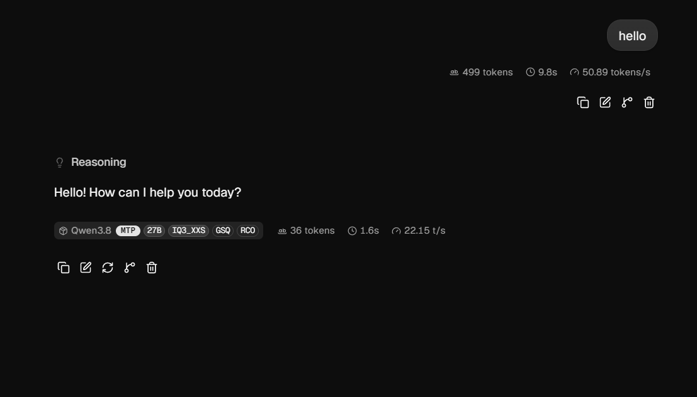
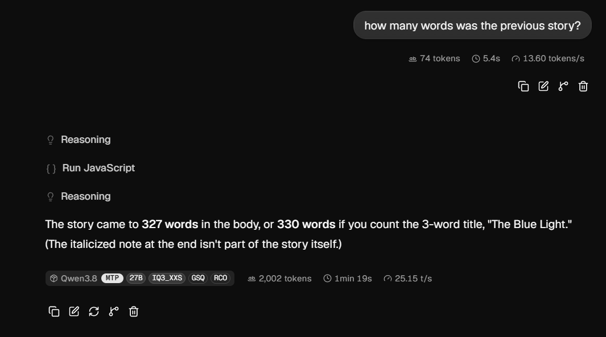
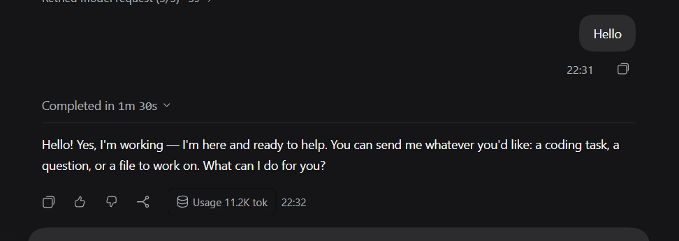

# Local AI on a PS5 Slim: Qwen3.8 27B Server, Harness on My Laptop

Running a 27B AI model on a PS5 Slim under Linux, and using it from a coding harness on my laptop over the home network. Each problem I hit is written as **problem, cause, solution**.

**Part 1:** getting Linux to boot on the PS5 is in [the boot guide](../linux-boot/README.md).



*First test: Qwen3.8 27B answering from the PS5, at 22 tokens/sec.*

## At a glance

| # | Problem | Solution |
|---|---|---|
| 1 | A 14.5 GB model ran out of memory | Switch to a ~10-11 GB 3-bit model with MTP |
| 2 | Ubuntu's memory guard killed the server while the desktop was running | Boot to text mode and run headless |
| 3 | Stopping the desktop mid-session froze the keyboard | Set text mode as the default boot target |
| 4 | Out-of-memory crash during a tool loop | Load the model once instead of memory-mapping it |
| 5 | `--no-mmap` rejected as an invalid argument | My llama.cpp version renamed it to `--load-mode none` |
| 6 | The harness keeps running into out-of-memory errors | Open: try other harnesses and models |

## Architecture

```
Laptop (harness)  --Ethernet / home network-->  PS5 Slim (llama-server, Vulkan GPU, headless)
```

- **PS5:** runs `llama-server` from llama.cpp in text mode, with the whole model on the GPU. It exposes an OpenAI-compatible API on port 1234, protected by an API key.
- **Laptop:** runs the harness, pointed at the PS5 instead of a cloud API.

## Hardware and software

| Item | Detail |
|---|---|
| Server | PS5 Slim, firmware 13.60, Ubuntu 26.04 (setup in [Part 1](../linux-boot/README.md)) |
| GPU memory | 512 MB dedicated + ~14.1 GB shared (after raising the TTM limit) |
| Inference | [llama.cpp](https://github.com/ggml-org/llama.cpp), Vulkan backend |
| Model | `Qwen3.8-27B-GSQ-RCO-IQ3_XXS-mtp.gguf` (27B, 3-bit, with MTP) |
| Harness | DeepSeek harness |
| Network | Ethernet |

## Based on

- Video guide: [I ran Qwen 27B on PS5 (and It's Fast!)](https://www.youtube.com/watch?v=9efQr3ljWQk) by Red Stapler. My model choice and server flags follow it.

---

## Setup

### 1. Build llama.cpp with Vulkan

```bash
sudo apt install build-essential cmake git libvulkan-dev glslc
git clone https://github.com/ggml-org/llama.cpp
cd llama.cpp
cmake -B build -DGGML_VULKAN=ON
cmake --build build --config Release -j
```

Note: the video clones with `--depth 1`, which downloads only the latest version and skips the full history. Faster and smaller, but either works.

### 2. Raise the GPU memory limit

The PS5's CPU and GPU share 16 GB. By default, Linux lets the GPU use far less than that. Raising the TTM page limit in `cmdline.txt` (as in the video) gives the GPU about 14.1 GB of shared memory. I set the limit to **4063232** pages (pages are 4 KB each):

```
ttm.pages_limit=4063232
```

Check what the GPU can use:

```bash
cat /sys/class/drm/card*/device/mem_info_gtt_total    # shared: 15137722368 bytes (~14.1 GB)
cat /sys/class/drm/card*/device/mem_info_vram_total   # dedicated: 536870912 bytes (512 MB)
```

The 512 MB is the default from `vram.txt`. The loader project keeps it small on purpose so the GPU borrows memory dynamically, so I left it alone.

### 3. Run the server from a script

`~/start-ai.sh`:

```bash
#!/bin/bash
cd ~/llama.cpp
./build/bin/llama-server -m <insert model path here> -ngl 99 -fa on -c 60000 -ctk q4_0 -ctv q4_0 -np 1 -b 1024 -ub 512 -lm none --host 0.0.0.0 --port 1234 --temp 1 --top-k 20 --min-p 0 --top-p 0.95 --spec-type draft-mtp --spec-draft-n-max 3 --api-key <your-key>
```

Make it runnable with `chmod +x ~/start-ai.sh`, then run `~/start-ai.sh`. Stop it with `Ctrl + C`.

What the flags do:

| Flags | Purpose |
|---|---|
| `-ngl 99` | Put the whole model on the GPU |
| `-c 60000` | 60K-token context |
| `-ctk q4_0 -ctv q4_0` + `-fa on` | Compress the context memory to 4-bit. This is what makes 60K fit. |
| `-np 1` | One conversation at a time, so all memory goes to it |
| `-b 1024 -ub 512` | How much of a prompt is processed at once |
| `-lm none` | Short for `--load-mode none`: load the model once, without memory-mapping (see Problem 4) |
| `--temp 1 --top-k 20 --min-p 0 --top-p 0.95` | Recommended settings for the model's thinking mode |
| `--spec-type draft-mtp --spec-draft-n-max 3` | MTP: guess 3 tokens ahead for faster replies |
| `--host 0.0.0.0 --port 1234` | Reachable from the laptop |
| `--api-key` | Require a key. Without it, anyone on the network could use the server. |

### 4. Optional: boost mode

The loader project's tools can raise the CPU to 3500 MHz and the GPU to 2230 MHz. Always turn the fan on first.

```bash
cd ~/ps5-linux-tools
sudo ./ps5_control --fan on
sudo ./ps5_control --boost on
```

### 5. Connect from the laptop

- Built-in chat page: `http://<ps5-ip>:1234`
- Harness, as an OpenAI-compatible endpoint: `http://<ps5-ip>:1234/v1` with the same API key

Harness settings I used:

| Setting | Value | Why |
|---|---|---|
| Context window | 60000 | Matches the server's `-c`. Never set it higher than the server. |
| Max output tokens | 16384 | The model's reasoning counts as output, so it needs room |

---

## Problems and fixes

### Problem 1: a 14.5 GB model ran out of memory

**Cause:** the model file alone nearly filled the ~14.6 GB the GPU can use, with nothing left for context or MTP. A 12.8 GB file would have left under 2 GB, too little for a useful context.

**Solution:** I switched to the ~10-11 GB IQ3_XXS file with MTP built in, the one used in the video. That leaves about 3-4 GB for 60K context and MTP.

### Problem 2: the server was killed while the desktop was running

**Symptom:** GNOME showed a notification that an application was using too much memory and was stopped.

**Cause:** Ubuntu's memory guard (systemd-oomd) killed the server. The desktop and the model were sharing the same 16 GB.

**Solution:** run headless (see Problem 3).

### Problem 3: stopping the desktop froze the keyboard

**Symptom:** after `sudo systemctl stop gdm3`, the screen dropped to a blinking cursor and the keyboard stopped responding, so I couldn't switch to a login console.

**Solution:** boot straight into text mode instead:

```bash
sudo systemctl set-default multi-user.target
sudo reboot
```

To get the desktop back permanently: `sudo systemctl set-default graphical.target`.

Note: after rebooting, the boot log showed a DisplayPort clock-recovery error. This is the display-link issue covered in [Part 1](../linux-boot/README.md), and the boot continued.

### Problem 4: out-of-memory crash during a tool loop

**Symptom:** in the chat page, the model called the "Run JavaScript" tool several times in a row, then the server crashed with an out-of-memory error.

**Likely cause:** by default, llama.cpp memory-maps the model file, which can keep it in RAM while also loading it onto the GPU. On the PS5, both draw from the same shared memory, so that leaves very little headroom.

**Solution:** load the model once with `-lm none` (`--load-mode none`). With it, the harness test completed. Turning off the "Run JavaScript" tool in the chat page also avoids unneeded tool loops.

**Trade-off:** with this setting, reply speed dropped to about 17-18 tokens/sec, down from 22-25. I haven't tested why yet.

### Problem 5: `--no-mmap` was rejected

**Symptom:** `invalid argument --no-mmap`, and the same for `--mmap`.

**Cause:** my llama.cpp version replaced it with a `--load-mode` option.

**Solution:** I found the new name in the help text:

```bash
./build/bin/llama-server --help | grep -i -B 2 -A 2 mmap
```

`--load-mode none` (short: `-lm none`) is the equivalent of the old `--no-mmap`.

### Problem 6: the harness keeps running out of memory

**Symptom:** the DeepSeek harness works, but keeps running into out-of-memory errors.

**Likely cause:** the harness sends ~11K tokens of instructions and tool definitions on every request. On top of a 27B model with 60K context and MTP, that leaves almost no headroom in 14.6 GB.

**Status: open.** Next steps:
- **Try other harnesses,** especially lighter ones that send fewer instructions per request
- **Try other models:** a smaller one, or the same model without MTP, to free memory for context

---

## Results

| Test | Prompt speed | Reply speed | Notes |
|---|---|---|---|
| "hello", no boost | 51 t/s (499 tokens) | 22 t/s | |
| Short story + word count, boost on | n/a | 25 t/s (2,002 tokens) | The model wrote the story, then used the JavaScript tool to count its own words |
| Harness test with `-lm none` | n/a | 17-18 t/s | Completed without crashing, but slower |
| "Hello" in the harness | ~11.2K tokens in ~1.5 min | n/a | Almost all of those tokens are the harness's own instructions and tool definitions |





The prompt-speed figure from the short "hello" test is low partly because short prompts always measure slower. The harness test gives a better sense of real prompt speed.

**What the numbers mean in practice:**

- Replies at 22-25 tokens/sec are faster than reading speed.
- Reading long prompts is the slow part. A harness sends ~11K tokens of instructions per request, so the first reply in a session takes about 1.5 minutes. llama.cpp caches what it has already read, so follow-ups only process the new part.
- The harness retried the first request 3 times while waiting. Raising its timeout avoids that.

## What I would do differently

- **Check the model file size against the GPU memory budget before downloading.** Model + context + MTP all have to fit.
- **Set text mode as the default before running the server,** instead of stopping the desktop mid-session.
- **Change one thing at a time.** I turned on boost without applying the other memory fixes, so I couldn't tell which change made the crash go away.
